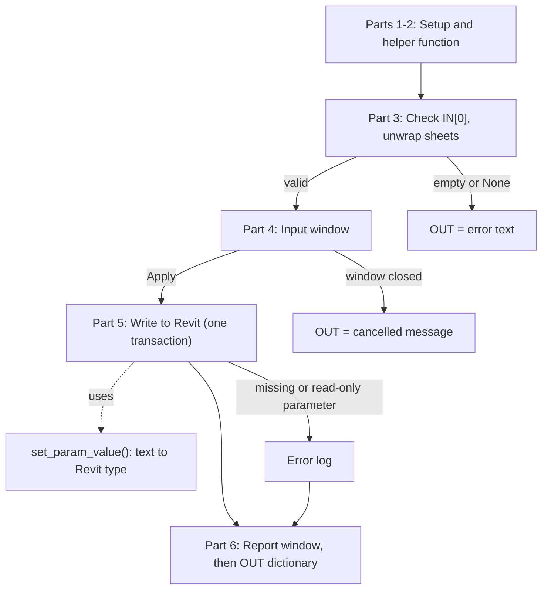

# Populate Multiple Sheet Parameters

Revit sheet batch parameter automation through Dynamo. For application of one or more same value sheet parameters to multiple sheets. 

## 🏢The Problem

Revit sheets contain multiple parameters whose values frequently change throughout a project's duration. In practice, managing these changes typically relies on two manual methods: generating a sheet list schedule to input values cell-by-cell, or selecting individual sheets to update their properties via the Properties palette. Both approaches are incredibly tedious and time-consuming, scaling poorly when dealing with dozens or hundreds of sheets across a large-scale project. 

## 💻What It Does

Sheets are grouped through a filter grouping parameter value. Dynamo player would require a filter parameter name and value input to specify sheets for application. Upon running the script, dynamo prompts an input window wherein the users can add one or more parameter names and values. These values will be applied and reflected on the and output window. Output will show 2 sections, an errors or missing parameters section and a successful parameter replacement section. 

## 🛠️Tools 

- Autodesk Revit 2025 Architectural Sample Model --  BIM model and source data 
- Dynamo v.3.3.0 -- Automated Revit data extraction
- Python -- Revit API-based element collection and geometry filtering

## 🔧How It Works

```
User inputs sheet filter grouping parameter name and value  
                            |
                            v
Dynamo filters sheet based on input parameter name and value 
                            |
                            v
Dynamo collects all sheet elements from selected sheets
                            |
                            v
Python script displays input window 
                            |
                            v
User adds one or more input parameter names and values
                            |
                            v
Python script writes each parameter values to each sheet 
                            |
                            v
Python script generate report window showing errors in red and successes in green
```

## 📊Dynamo Graph


[View PopulateMultipleTitleBlockSheetParameters dynamo script](dynamo/PopulateMultipleSheetParameters.dyn)  

Dynamo script walkthrough 

1. Selects all sheet elements through Categories and All Elements of Category nodes
2. Filters sheets through a filter parameter name and value with Element.GetParameterValueByName, ==, and List.FilterByBoolMask 
3. Filtered sheets are connected to a SetSheetParameters Python Script which display input window, replaces parameter values, and generates report window 

## 📄SetSheetParameters.py Deep Dive

A Dynamo Python node that writes parameter values onto a list of Revit sheets. You wire in the sheets, type the parameter names and values into a small window, and the script applies them to every sheet, then shows a report of what worked and what failed.

[View SetSheetParameters python script](dynamo/SetSheetParameters.py) 

🧭 <ins>__Overview__</ins>

| | |
|---|---|
| **Input** | `IN[0]`: a list of sheets (Dynamo sheet objects or Revit elements) |
| **User input** | A pop-up window with editable *Parameter Name / Value to Set* rows |
| **Action** | Writes each value to each sheet inside one Revit transaction |
| **Feedback** | A pop-up report window listing errors and updated sheets |
| **Output** | `OUT`: a dictionary of counts and lists (or a text message) |

**Requirements:**Python node engine set to **CPython3** (the script uses f-strings), and Windows (the windows are built with WPF). Set Dynamo's run mode to **Manual**, otherwise any upstream change reopens the window.

🔗 <ins>__How it flows__</ins>



The whole script is wrapped in a `try/except`, so any unexpected error returns `Global Script Error: ...` in `OUT` instead of a red node. The Revit transaction is closed in a `try/finally` (see Part 5), so it is always closed, even in that case.

1️⃣ <ins>__Part 1: Imports and setup__</ins>

```python
clr.AddReference('PresentationFramework')
clr.AddReference('PresentationCore')
clr.AddReference('WindowsBase')
from System.Windows import Window, Thickness, ...
from System.Windows.Controls import Button, StackPanel, Grid, TextBox, ...

from RevitServices.Persistence import DocumentManager
from RevitServices.Transactions import TransactionManager
from Autodesk.Revit.DB import StorageType, ElementId

doc = DocumentManager.Instance.CurrentDBDocument
raw_input = IN[0]
```

`clr.AddReference` loads .NET libraries. The first three are **WPF**, the Windows toolkit used to draw the windows, buttons and text boxes in code. `DocumentManager` gives the open Revit document (`doc`), and `TransactionManager` lets the script edit it safely. `raw_input` is whatever is wired into the node.

2️⃣ <ins>__Part 2: Helper function `set_param_value()`__</ins>

```python
def set_param_value(param, val_str):
    st = param.StorageType
    if st == StorageType.String:
        return param.Set(str(val_str))
    elif st == StorageType.Integer:
        v_clean = str(val_str).strip().lower()
        if v_clean in ['true', 'yes', '1']:
            return param.Set(1)
        elif v_clean in ['false', 'no', '0']:
            return param.Set(0)
        return param.Set(int(v_clean))
    ...
```

Revit parameters have a fixed storage type, but the window only gives text. This function converts the typed text before writing it:

| Storage type | Accepted text |
|---|---|
| String | anything, written as typed |
| Integer | `true` / `yes` / `1` (sets 1), `false` / `no` / `0` (sets 0), or a whole number |
| Double | a number, converted with `float()` |
| ElementId | an integer element ID |

It returns whether `param.Set(...)` succeeded.

3️⃣ <ins>__Part 3: Check and unwrap the input__</ins>

```python
wrapped_sheets = raw_input if isinstance(raw_input, list) else [raw_input]
wrapped_sheets = [s for s in wrapped_sheets if s is not None]
...
for s in wrapped_sheets:
    if hasattr(s, "InternalElement"):
        db_sheets.append(s.InternalElement)
    else:
        db_sheets.append(s)
```

The script makes sure it always has a list, drops nulls, and stops with a message if the input is `None` or has no valid sheets. Dynamo wraps Revit elements in its own objects, so `InternalElement` is used to get the underlying Revit sheet that has `SheetNumber` and `LookupParameter`.

4️⃣ <ins>__Part 4: The input window__</ins>

```python
def add_parameter_row(default_name="", default_val=""):
    grid = Grid()
    ...
    tb_name = TextBox()
    tb_val = TextBox()
    btn_del = Button()          # red "✕" removes this row
    ...
    param_row_controls.append((tb_name, tb_val))

add_parameter_row("Drawn By", "")
```

The window is built entirely in code (no XAML). Each row is a grid with a parameter-name box, a value box and a delete button. `param_row_controls` remembers every row's two text boxes so their contents can be read later. **+ Add Parameter** adds another row, and the first row starts as `Drawn By`.

```python
if win.ShowDialog() == True:
    param_updates = []
    for tb_name, tb_val in param_row_controls:
        p_name = tb_name.Text.strip()
        if p_name:
            param_updates.append((p_name, tb_val.Text))
```

`ShowDialog()` pauses Dynamo until the window closes. Clicking **Apply** sets `DialogResult = True`; closing the window any other way ends with `Operation cancelled by user.` Rows with a blank name are skipped.

 5️⃣ <ins>__Part 5: Writing to Revit__</ins>

```python
TransactionManager.Instance.EnsureInTransaction(doc)
try:
    for sheet in db_sheets:
        for p_name, p_val in param_updates:
            param = sheet.LookupParameter(p_name)
            if param is None:
                error_logs.append((p_name, f"Parameter '{p_name}' does not exist on sheet {label}."))
            elif param.IsReadOnly:
                error_logs.append((p_name, f"Parameter '{p_name}' is read-only on sheet {label}."))
            else:
                success = set_param_value(param, p_val)
                ...
finally:
    # Always close the transaction, even if something unexpected fails inside the loop
    TransactionManager.Instance.TransactionTaskDone()

doc.Regenerate()
```

Revit only allows edits inside a transaction. The loop sits inside a `try` block, and `TransactionTaskDone()` is in the matching `finally` block, so the transaction is **always closed**, whether the loop finishes normally or fails. For every sheet and every parameter row the script looks the parameter up, logs an error if it is missing or read-only, and otherwise writes the converted value.

Two kinds of problems are handled differently:

- **Expected problems** (missing or read-only parameter, a value that cannot be converted) are caught one by one and added to the error log, so the other sheets and parameters still run.
- **Unexpected failures** inside the loop close the transaction through `finally`, then fall through to the global `try/except`. `OUT` becomes `Global Script Error: ...`, and `doc.Regenerate()` and the report window are skipped.

Three collections record the outcome:

- `error_logs`: pairs of parameter name and message
- `successful_sheets`: a set of labels such as `A101 - Floor Plan`
- `successful_params`: a set of parameter names that were written


6️⃣ <ins>__Part 6: Report window and output__</ins>

```python
parts = err.split(f"'{p_name}'")
...
p_run = Run(p_name)
p_run.TextDecorations = TextDecorations.Underline
```

A second window opens. The **error section** (red, shown only if there are errors) underlines the parameter name inside each message and ends with a total. The **success section** builds a sentence such as *"Successful replacement of Parameters A, B, and C for sheets:"* with the names underlined, then lists each sheet with a total. A **Close** button ends the window.

```python
OUT = {
    "TotalErrors": len(error_logs),
    "TotalUpdatedSheets": len(successful_sheets),
    "Errors": [e[1] for e in error_logs],
    "UpdatedSheets": sorted(list(successful_sheets)),
    "UpdatedParameters": sorted(list(successful_params))
}
```

The dictionary goes back to Dynamo for a Watch node. Other possible outputs are plain text messages: `Error: ...`, `Operation cancelled by user.` and `Global Script Error: ...`.


## ©️License 
MIT. See [LICENSE](../LICENSE)
