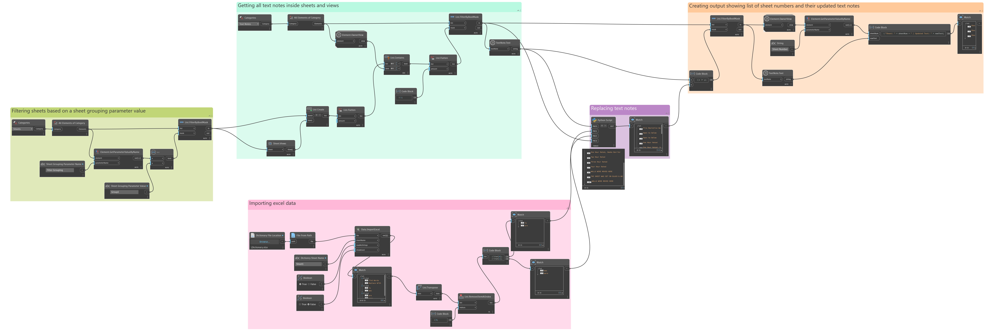
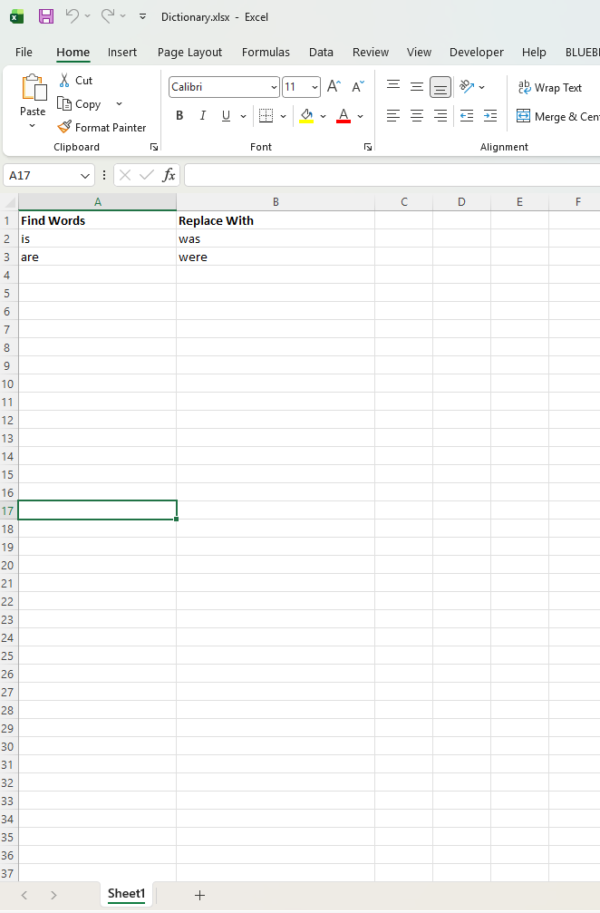
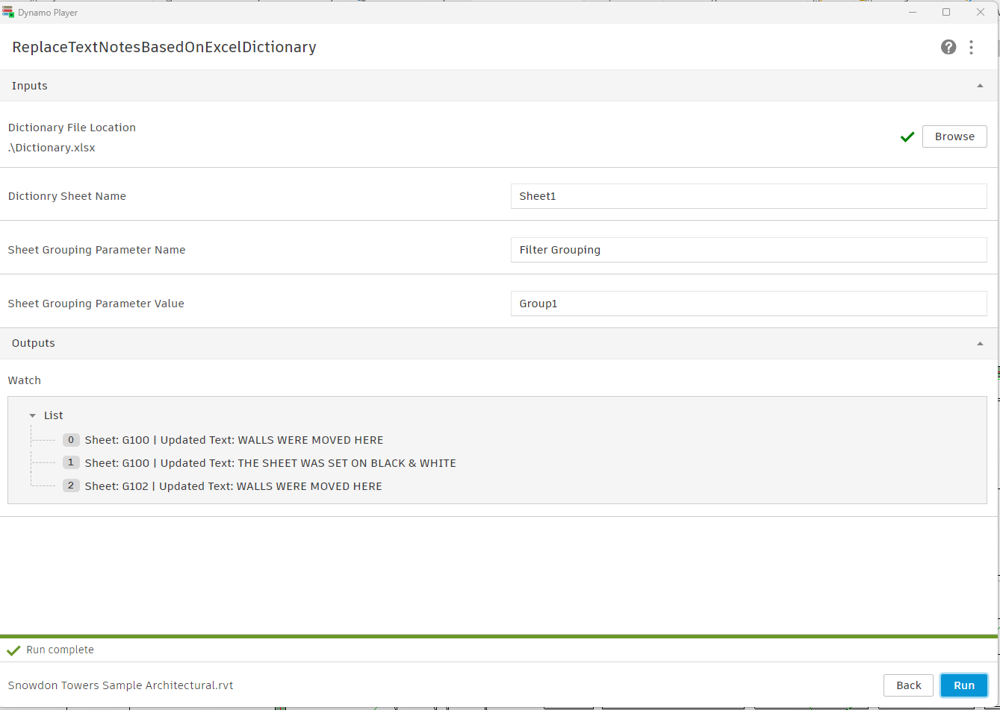
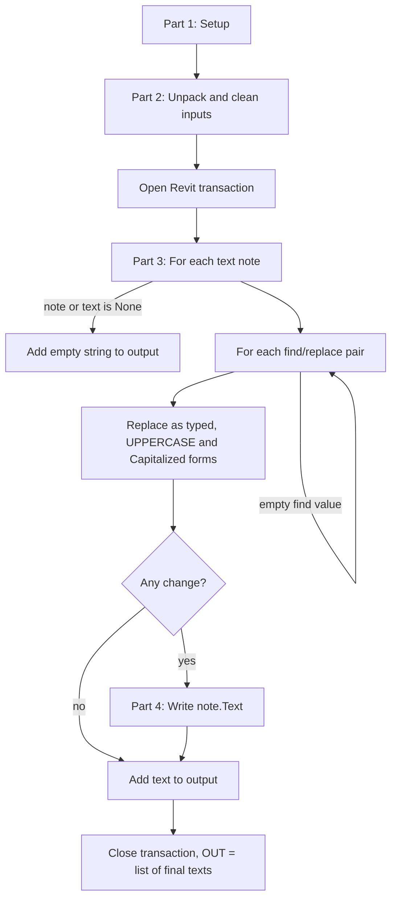

# Replace Text Notes Based on Excel Dictionary

Revit text note batch find-and-replace through Dynamo and an Excel dictionary. For standardizing wording, spelling or terminology across the text notes on a group of sheets and the views placed on them.

## 🏢The Problem

Text notes on Revit sheets (general notes, keynotes, specification callouts, legend text) tend to drift in wording across a project. Standardizing a term, correcting a spelling or updating a phrase usually relies on two manual methods: opening each sheet and view to edit the notes one by one, or using Revit's Find/Replace tool, which only handles one search term at a time. Both approaches are tedious, easy to get wrong, and scale poorly across dozens or hundreds of sheets.

## 💻What It Does

Sheets are grouped through a filter grouping parameter value. Dynamo Player asks for the filter parameter name and value, the location of an Excel dictionary file, and the name of the dictionary sheet. The dictionary is a simple two-column list of words or phrases to find and what to replace them with. Upon running the script, every text note on the selected sheets and on the views placed on those sheets is checked against every dictionary entry, and notes that contain a match are rewritten in the model. The output lists each changed note with its sheet number and its updated text.

## 🛠️Tools 

- Autodesk Revit 2025 -- BIM model and text note source data
- Dynamo v.3.3.0 -- Automated Revit data extraction and write-back
- Clockwork for Dynamo 3.x (v.3.3.0) -- Package node used to find the view that owns each text note
- Excel -- Replacement dictionary (`Dictionary.xlsx`, sample included)
- Python (CPython3) -- Whole-word find and replace and write-back to Revit text notes

## 🔧How It Works

1. User inputs the sheet filter grouping parameter name and value, the dictionary file location and the dictionary sheet name  


2. Dynamo filters sheets based on the input parameter name and value

3. Dynamo collects every text note whose owner is one of the filtered sheets or a view placed on one of them

4. Dynamo imports the Excel dictionary and splits it into a list of find words and a list of replacement words

5. Python script runs every dictionary entry against each text note and keeps whole-word matches only


6. Python script writes the changed text back to each text note that was modified

7. Dynamo compares the original and new text, and generates an output listing only the notes that changed, each with its sheet number


Demo


## 📊Dynamo Graph


[View ReplaceTextNotesBasedOnExcelDictionary dynamo script](dynamo/ReplaceTextNotesBasedOnExcelDictionary.dyn)  

**Player inputs**

| Input | Default | Purpose |
|---|---|---|
| Sheet Grouping Parameter Name | `Filter Grouping` | Sheet parameter used to select sheets |
| Sheet Grouping Parameter Value | `Group1` | Value the parameter must equal |
| Dictionary File Location | `.\Dictionary.xlsx` | Excel dictionary file (relative to the `.dyn`, or a full path) |
| Dictionary Sheet Name | `Sheet1` | Worksheet in the Excel file that holds the dictionary |

Dynamo script walkthrough, following the five groups in the graph

1. **Filtering sheets based on a sheet grouping parameter value.** Selects all sheet elements through Categories (`OST_Sheets`) and All Elements of Category nodes, then filters them with Element.GetParameterValueByName, ==, and List.FilterByBoolMask
2. **Getting all text notes inside sheets and views.** Selects all text notes in the model through Categories (`OST_TextNotes`) and All Elements of Category. The views placed on each filtered sheet are collected with Sheet.Views and combined with the sheets into one flattened list. A Clockwork node returns the owner view of every text note, List.Contains checks whether that owner is in the list, and List.FilterByBoolMask keeps only the matching text notes
3. **Importing Excel data.** Data.ImportExcel reads the dictionary sheet as strings (Excel is not opened on screen). The result is transposed with List.Transpose into one list per column, List.RemoveItemAtIndex (index `0`) drops the header from each list, and a code block (`list[0]; list[1];`) splits the data into the find list and the replace list
4. **Replacing text notes.** The text notes, their current text, and the find and replace lists are connected to a Python Script node which performs the replacement and writes the result to Revit
5. **Creating output showing list of sheet numbers and their updated text notes.** The original text is compared with the Python output (`x != y`), and only the changed notes are kept. For each one, the owner view's `Sheet Number` and the new text are joined into a line such as `Sheet: A101 | Updated Text: ...` and shown in a Watch node

### 📘 Dictionary format

The dictionary is read from the worksheet named in the input. Row 1 is a header row and is not used as an entry. Each row after it is one find and replace pair, in two columns:

| Column A | Column B |
|---|---|
| Find Words | Replace With |
| is | was |
| are | were |

Entries are applied in the order they appear in the sheet. Columns C onward are ignored by the graph, so they can hold categories, notes or check formulas.

A ready-to-use sample is included: [View sample Dictionary.xlsx](dynamo/Dictionary.xlsx). Keep it next to the `.dyn` file so the default `.\Dictionary.xlsx` path works.

### 🧩 Where this can be applied

The same graph covers many situations in a drawing set. Only the dictionary and the sheet group change.

| Situation | Example (Find → Replace) | Sample sheet |
|---|---|---|
| Standardize abbreviations | `ALUM` → `ALUMINUM`, `CLG` → `CEILING`, `TYP` → `TYPICAL` | `Abbreviations` |
| Convert spelling variants (UK to US) | `colour` → `color`, `metres` → `meters`, `storey` → `story` | `Spelling` |
| Align terminology with a project or regional standard | `sheetrock` → `gypsum board`, `car park` → `parking garage` | `Terminology` |
| Standardize fire rating wording | `1-HR` → `One Hour`, `2 HR` → `Two Hour` | `Fire Rating` |
| Make responsibility wording consistent | `OFCI` → `OWNER FURNISHED, CONTRACTOR INSTALLED` | `Responsibility` |
| Fix repeated typos before issuing | `recieve` → `receive`, `seperate` → `separate` | `Typos` |
| Update a code or standard edition | `IBC 2018` → `IBC 2021` | `Code References` |
| Update status wording for a new issue | `FOR REVIEW` → `FOR CONSTRUCTION` | `Drawing Status` |
| Apply a project or company rename | `Old Project Name` → `New Project Name` | `Project Names` |

Practical ways to use it:

- **Clean up an imported or merged set.** Run the standardizing dictionaries on sheets that came from other templates, offices or consultants.
- **Prepare for an issue.** Run `Typos` and `Drawing Status` on only the sheet group being issued by using the sheet grouping parameter.
- **Target one discipline or phase.** Group sheets with a parameter such as `Filter Grouping`, then run a dictionary on that group only.
- **Run one theme at a time.** Type a sheet name such as `Fire Rating` in the Dictionary Sheet Name input to apply only that sheet's entries. `Sheet1` in the sample combines the general-purpose sheets (everything except `Code References`, `Drawing Status` and `Project Names`, which are project-specific).

Guidance for building your own dictionary:

- List multi-word phrases above the single words they contain (`gyp bd` before `bd`).
- Avoid chains, where one row's replacement is another row's find word. The sample's `Check` column flags duplicates and chains.
- Avoid find words that start or end with a symbol. `U.N.O.` will not match, but `UNO` will.
- Short everyday words (`lift`, `min`) can appear in notes where you do not want them changed. Test on a small sheet group first.
- Mixed results are possible when a note is partly matched. For example `1-HR RATED` becomes `One Hour RATED` unless a row such as `1-HR RATED` exists.
- Unit or number conversions (`3/4"` to `19 mm`) are not a good fit, because text is matched literally.

## 📄ReplaceTextNotes.py Deep Dive

A Dynamo Python node that applies a list of find and replace pairs to a list of Revit text notes. You wire in the text notes, their current text, and the find and replace lists, and the script rewrites every note that contains a match, then returns the final text of every note.

[View ReplaceTextNotes python script](dynamo/ReplaceTextNotes.py) 

🧭 <ins>__Overview__</ins>

| | |
|---|---|
| **Input** | `IN[0]`: current text of each text note (list of strings) |
| | `IN[1]`: find words, from the dictionary |
| | `IN[2]`: replacement words, from the dictionary |
| | `IN[3]`: the Revit text notes, in the same order as `IN[0]` |
| **Action** | Replaces whole-word matches in each note, then writes changed notes back inside one Revit transaction |
| **Output** | `OUT`: list with the final text of every note, changed or not |

**Requirements:** Python node engine set to **CPython3**. Set Dynamo's run mode to **Manual**, otherwise any upstream change reruns the replacement.

🔗 <ins>__How it flows__</ins>



1️⃣ <ins>__Part 1: Imports and setup__</ins>

```python
import clr
import re

clr.AddReference("RevitServices")
import RevitServices
from RevitServices.Transactions import TransactionManager
```

`clr.AddReference` loads the Revit services library. `re` is Python's regular expression module, used for whole-word matching. `TransactionManager` lets the script edit the Revit document safely.

2️⃣ <ins>__Part 2: Unpack and clean the inputs__</ins>

```python
text_inputs = IN[0] if isinstance(IN[0], list) else [IN[0]]
old_inputs  = IN[1] if isinstance(IN[1], list) else [IN[1]]
new_inputs  = IN[2] if isinstance(IN[2], list) else [IN[2]]

revit_notes = (
    UnwrapElement(IN[3])
    if isinstance(IN[3], list)
    else [UnwrapElement(IN[3])]
)

old_words = [str(x) if x is not None else "" for x in old_inputs]
new_words = [str(y) if y is not None else "" for y in new_inputs]
```

Each input is forced into a list, so a single text note works as well as many. `UnwrapElement` converts Dynamo's wrapped text notes into the underlying Revit elements, which is what allows the `Text` property to be set. Empty cells in the dictionary become empty strings.

3️⃣ <ins>__Part 3: Whole-word find and replace__</ins>

```python
for note_element, original_text in zip(revit_notes, text_inputs):
    ...
    for old, new in zip(old_words, new_words):
        if old.strip() == "":
            continue

        pattern = r"\b" + re.escape(old) + r"\b"
        new_text, count = re.subn(pattern, new, current_text)
```

Each text note is paired with its current text. For every dictionary pair, the script builds a pattern from the find word. `\b` is a word boundary, so only whole words match. Empty find values are skipped.

| Find | Replace | Text | Result |
|---|---|---|---|
| `is` | `was` | `This is` | `This was` |
| `is` | `was` | `wish` | `wish` (unchanged) |
| `is` | `was` | `isometric` | `isometric` (unchanged) |

Each pair is tried in three forms, so one dictionary row covers the common ways text is typed on a drawing:

| Form | Find | Replace |
|---|---|---|
| As typed in the dictionary | `verify` | `verified` |
| UPPERCASE | `VERIFY` | `VERIFIED` |
| Capitalized | `Verify` | `Verified` |

Pairs run one after another on the same text, so the output of one pair is the input of the next.

4️⃣ <ins>__Part 4: Writing to Revit__</ins>

```python
TransactionManager.Instance.EnsureInTransaction(doc)
...
    if has_changed:
        try:
            note_element.Text = current_text
        except:
            pass

    output_strings.append(current_text)

TransactionManager.Instance.TransactionTaskDone()

OUT = output_strings
```

Revit only allows edits inside a transaction. A note is only written back when at least one replacement happened, so untouched notes are never modified. The final text of every note, changed or not, is collected in `output_strings` and returned as `OUT`. The graph compares `OUT` with the original text to build the list of changed notes.

## ⚠️ Things to know

- **Changes are written immediately.** There is no preview step. Run the script on a test group first, and use Revit's Undo if the result is not what you wanted.
- **Order of the dictionary matters.** Pairs run top to bottom on the same text, so a later pair can match the output of an earlier one (`a → b` followed by `b → c` turns `a` into `c`).
- **Only three letter-case forms are matched.** As typed, UPPERCASE and Capitalized. A mixed form such as `vErify` is not matched. The Capitalized form uses Python's `capitalize()`, which also lowercases the rest of a multi-word entry (`fire rated door` becomes `Fire rated door`).
- **Whole words only.** `\b` matching can miss find values that start or end with a symbol (for example `#` or `(`).
- **Backslashes in the replacement.** The replacement text is used as a regular expression template, so a backslash in the Replace column can be interpreted as an escape.
- **Silent write failures.** If a note cannot be edited (for example it is on a workshared element owned by another user), the error is skipped without a message. That note still appears in the output with its new text, so check the model if a note looks unchanged.
- **Text formatting may reset.** Setting a note's `Text` replaces the full string, so character-level formatting inside a note (bold, underline, lists) may not be preserved.
- **Which notes are included.** Text notes placed directly on the filtered sheets, and text notes inside the views placed on those sheets. Text notes in views that are not on a filtered sheet are left alone.
- **Keep a header row and two columns.** Row 1 is always dropped, so the first real entry must start in row 2. Column A holds the words to find and Column B the replacements. Avoid blank rows in the middle of the list.


## ©️License 
MIT. See [LICENSE](../LICENSE)
