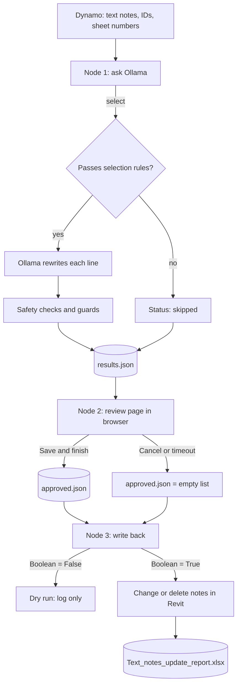

# Text Note Language Markup with Ollama

Revit text note language markup through Dynamo and a local AI model (Ollama). For rewriting the wording of text notes on selected sheets and their views according to a set of editable rules, with a human review step before anything touches the model.

## 🏢The Problem

Models converted from IFC, or carried over from design and construction stages, still hold text notes written as design intent: "Install anchors as required", "Contractor to verify dimensions on site", "Door is to be painted". Once the building is built, nothing is pending any more, and as-built documentation should read as a record of what was done: "Installed anchors", "Door was painted".

In practice, fixing this relies on two manual methods: opening each sheet and view to edit every text note by hand, or using a find-and-replace dictionary. A dictionary works for fixed word swaps but fails on real sentences. It cannot turn "is to be removed" into "was removed", delete a whole "architect to confirm" clause, or know when nothing meaningful is left and the note should go. Both approaches scale poorly across dozens or hundreds of sheets. Cloud AI tools are also not an option for many projects, as drawing text should not leave the machine.

## 💻What It Does

Sheets are grouped through a filter grouping parameter value. Dynamo collects every text note placed on those sheets and in the views placed on them, then sends the text to a **local** Ollama model that rewrites it using only the rules in `rules.json` (for example removing "as required" phrases, deleting pending-input phrases such as "TBC", and changing verbs to past tense). Nothing is sent outside the computer.

A review page then opens in the browser, showing each original note beside the proposed one with changes highlighted. The user approves, rejects or edits each note. Only approved notes are written back to Revit. Notes whose words were all removed are deleted, as Revit does not allow an empty text note. A cumulative Excel report lists every note that was actually changed in the model.

Writing back has a **dry run** mode (default) that logs what would happen without changing anything.

### 🔄 Improvement on ReplaceTextNotesBasedOnExcelDictionary

This graph is the next step after the **ReplaceTextNotesBasedOnExcelDictionary** graph (Dynamo 3.3.0, Clockwork package). That graph filters sheets by a grouping parameter, then replaces text in the notes on those sheets and their views using `Dictionary.xlsx`, a two-column file of words to find and the words to replace them with. The sheet filtering and the text note collection carry over, and the replacement step changes from a dictionary to a local AI model with rules.

| | Dictionary graph | This graph |
|---|---|---|
| **Replacement logic** | Find and replace of fixed words from `Dictionary.xlsx` | Local Ollama model following editable rules in `rules.json` |
| **Handles sentences** | No, word by word | Yes: verb tenses, "is to be removed" → "was removed", removing whole phrases |
| **Deleting pending-input wording** | Not possible | Removes phrases such as "TBC" or "contractor to verify", and deletes the note if nothing is left |
| **Human check** | None before writing | Browser review page: approve, reject or edit each note |
| **Safety checks** | None | Protected numbers, tags and acronyms, line breaks, and removed text are checked and flagged |
| **Dry run** | No | Yes, on by default |
| **Change record** | None | Excel report of original and new text per Element ID |

## 🛠️Tools 

- Autodesk Revit 2025 Architectural Sample Model --  BIM model and source data 
- Dynamo v.3.3.0 -- Automated Revit text note extraction and write-back
- Ollama (v0.40.2) with `llama3.1:8b` -- Local AI model that rewrites the text notes
- Python (CPython3, standard library only) -- Ollama calls, safety checks, browser review page and Excel report

## 🔧How It Works

1. User inputs sheet filter grouping parameter name and value  


2. Dynamo filters sheets based on input parameter name and value 

3. Dynamo collects all text notes placed on the filtered sheets and in the views placed on them

4. Node 1 sends each eligible note to Ollama, applies the rules, and runs safety checks on the answer

5. Node 2 opens the review page in the browser


6. User approves, rejects or edits each proposed note, then clicks **Save & finish**

7. Node 3 replaces the text of every approved note (or deletes it if all words were removed)

8. Node 3 writes the changed notes to the Excel report (sheet number, Element ID, original text, new text, date of update)


Demo


## 📊Dynamo Graph


[View TextNoteLanguageMarkup dynamo script](dynamo/TextNoteLanguageMarkup.dyn)  

Dynamo script walkthrough 

**Filtering sheets based on a sheet grouping parameter value**

1. Selects all sheet elements through Categories and All Elements of Category nodes
2. Filters sheets through a filter parameter name and value with Element.GetParameterValueByName, ==, and List.FilterByBoolMask 

**Getting all text notes inside sheets and views**

3. Selects all text notes in the model through Categories and All Elements of Category nodes
4. Gets the views placed on the filtered sheets with Sheet.Views, and joins them with the sheets in one flattened list (List.Create, List.Flatten)
5. Gets the view or sheet each text note sits on with Element.OwnerView
6. Checks whether that owner is in the sheets-and-views list with List.Contains, and keeps only those text notes with List.FilterByBoolMask
7. Reads the note text with TextNote.Text and a Code Block mask removes the notes that should not be sent
8. A second List.FilterByBoolMask applies that mask to the text notes

**Connecting Text Notes to Ollama AI**

9. For each remaining text note, the graph collects the five lists Node 1 needs: Element.UniqueId, Element.Id, sheet number (Element.OwnerView, then Element.GetParameterValueByName with `Sheet Number`) and TextNote.Text
10. A folder path String (**AI Files**) points to the scripts folder, and a second String (**Report Output File Location**) sets where the Excel report is saved
11. The lists and paths feed **Node 1** (Python Script). Its output feeds **Review UI** (Node 2)

**Output Report**

12. The output of Node 2 and a Boolean (dry run switch) feed **Node 3** (Python Script), which writes to Revit and creates the Excel report

## 🗂️ Files

All files except the three node scripts must sit together in the folder given as **AI Files**.

| File | Role |
|---|---|
| `node1_ask_ollama.py` | Dynamo node 1: sends the notes to Ollama |
| `node2_review.py` | Dynamo node 2: opens the review page |
| `node3_write_back.py` | Dynamo node 3: writes back to Revit and creates the report |
| `ollama_client.py` | Ollama requests, selection, safety checks (loaded by node 1 and 2) |
| `review_ui.py` | Local web server and review page (loaded by node 2) |
| `report_xlsx.py` | Writes and updates the Excel report (loaded by node 3) |
| `rules.json` | Model, rules, examples and safety settings. Edit this to change behaviour |

Files created while running: `results.json` (proposals and decisions), `approved.json` (notes to apply), `review_decisions.csv` (full decision log), `review_url.txt`, and `Text_notes_update_report.xlsx`.

## 📄 Python Scripts Deep Dive

Three Dynamo Python nodes (all **CPython3**, Windows). They load the helper files from the scripts folder fresh on every run, so edits to `rules.json` or the helpers take effect without restarting Dynamo. Set Dynamo's run mode to **Manual**, otherwise any upstream change reruns Node 1 and Node 2 and reopens the review page.

🧭 <ins>__Overview__</ins>

| | Node 1: ask Ollama | Node 2: review UI | Node 3: write back |
|---|---|---|---|
| **Input** | `IN[0]` scripts folder, `IN[1]` unique IDs, `IN[2]` element IDs, `IN[3]` sheet numbers, `IN[4]` texts, `IN[5]` report folder | `IN[0]` path to `results.json` | `IN[0]` path to `approved.json`, `IN[1]` Boolean (dry run), `IN[2]` optional report folder |
| **User input** | None | Browser review page | The dry run Boolean |
| **Action** | Rewrites eligible notes with Ollama | Approve, reject or edit each note | Edits the model and updates the report |
| **Output** | Path to `results.json` | Path to `approved.json` | List: summary, report path, one log line per note |



1️⃣ <ins>__Node 1: ask Ollama__</ins>

```python
spec = importlib.util.spec_from_file_location("ollama_client", path)
ollama_client = importlib.util.module_from_spec(spec)
spec.loader.exec_module(ollama_client)            # fresh load on every run

notes = [{"unique_id": u, "element_id": e, "sheet_number": s, "text": t}
         for u, e, s, t in zip(IN[1], IN[2], IN[3], IN[4])]
ollama_client.run(notes, out_path=results_path, report_folder=IN[5])
```

The node loads `ollama_client.py`, zips the four Dynamo lists into one record per note, and runs the model on them. The report folder is only remembered in `results.json` (and checked immediately, so a bad path fails before the slow model run). The Excel file itself is written later by Node 3.

**Which notes are sent.** The `selection` block in `rules.json` decides. Notes that fail are kept with status `skipped` and a reason, and are never sent to the model.

| Check | Effect |
|---|---|
| `always_select` patterns | Notes with "as required" or pending-input phrases (TBC, "contractor to verify", ...) are always sent |
| `min_words`, `max_chars` | Too short or too long notes are skipped |
| `skip_patterns` | Short all-caps titles or tags, "See..." references and number-only notes are skipped |
| `require_any` | Otherwise the note must contain an action verb or a be/have/do form |
| `sheet_include`, `sheet_exclude` | Optional sheet filters |

**How a note is rewritten.** Each line of a note is sent to Ollama separately, so line breaks and blank lines are never lost. The system prompt is built from `rules.json` (task, enabled rules, "never change" list) and the worked examples are sent as earlier chat turns. `temperature` is 0 with a fixed `seed`, so the same note gives the same result.

Small models make mistakes, so the answer is checked before it is accepted:

| Safeguard | What it does |
|---|---|
| Unrelated answer check | Ignores answers that share almost nothing with the original (e.g. a copied example) and flags the note |
| `guard_removals` | Puts back any deleted word, punctuation or text that is not a removal phrase or a helper verb such as "is to be" |
| `restore_case` and `preserve_case` | Gives words the model kept their original capitalisation |
| `enforce` (`forced_replacements`) | Deterministically swaps verbs models often skip: is → was, are → were, has → had, ... |
| `validate` | Adds flags for changed line count, changed protected text (numbers, tags, acronyms), big length change, removed non-removal text or too many changed words |

Each note ends with a status: `skipped`, `unchanged`, `pending` (changed, no flags) or `flagged` (changed, needs a closer look).

2️⃣ <ins>__Node 2: review UI__</ins>

```python
OUT = sys.modules["review_ui"].run(IN[0], timeout_min=30)
```

Node 2 starts a small local web server on `127.0.0.1:8765` using only the Python standard library, opens the page in the default browser, and **pauses Dynamo** until the review is finished. The page shows a table with the sheet, the original text with removed words in red strikethrough, and an editable proposal with changed words in yellow.

| Control | Behaviour |
|---|---|
| Approve / Reject | Sets the decision for one note. Clicking again clears it |
| Editing the proposal | Edits are saved as the final text and the note is approved automatically |
| Filter | To review, Flagged, Approved, Rejected, Unchanged, Skipped (not applicable), All |
| Approve all clean | Approves every `pending` note. **Flagged notes are never approved by this button** |
| Save & finish | Writes `approved.json` and `review_decisions.csv`, then closes the server |
| Cancel | Nothing is applied |

Decisions are autosaved into `results.json`, so a review can be resumed. `approved.json` contains only notes that are approved **and** actually changed; a note with an empty final text gets `"delete": true`. If the review is cancelled or times out after 30 minutes, `approved.json` is an empty list. Any old `approved.json` is removed at the start, so an old approval is never reused. If port 8765 is busy, a clear message is raised and `port=8766` can be passed.

3️⃣ <ins>__Node 3: write back to Revit__</ins>

```python
TransactionManager.Instance.EnsureInTransaction(doc)
try:
    for a in approved:
        el = doc.GetElement(str(uid))
        if el is None or not isinstance(el, TextNote):  ...   # skipped
        elif norm(el.Text) != norm(a.get("old_text")):  ...   # skipped
        elif a.get("delete"):
            if apply_changes: doc.Delete(el.Id)
        else:
            if apply_changes: el.Text = a["new_text"]
finally:
    TransactionManager.Instance.TransactionTaskDone()
```

For every approved note the script finds the element by its unique ID and checks two things before touching it:

- The element still exists and is a text note
- The text is **identical to what was extracted**. If someone edited the note after extraction, it is skipped, so newer edits are never overwritten

Then the note is changed, or deleted when all its words were removed. Everything runs in one transaction, which is always closed through `finally`, and a failure on one note (for example an element owned by another user in a workshared model) is logged without stopping the others.

The Boolean on `IN[1]` is the **dry run switch**. `False` (also the default when nothing is wired) only logs what would happen and writes no report. `True` applies the changes.

**The Excel report** is created by `report_xlsx.py`, using the standard library only (no openpyxl needed), after the model was changed. It lists only notes that really were changed or deleted.

| Column | Content |
|---|---|
| Sheet number | Sheet the note sits on |
| Element ID | Revit element ID of the text note |
| Original text | Text before |
| New text | Text after, empty (red cell) if the note was deleted |
| Date of update | Date and time of the write-back |

The file is named `Text_notes_update_report.xlsx`, and is never renamed or recreated. If it exists it is updated in place, keeping your formatting and any extra columns. There is one row per Element ID: an Element ID already in the file has its row **replaced** with the newest values, a new one is added at the bottom. If the file cannot be written (usually because it is open in Excel), the rows are saved in `pending_report_rows.json` and added automatically next time.

The node returns `OUT` as a list for a Watch node: a summary line (`APPLIED` or `DRY RUN`, with counts of changed, deleted and skipped notes), the report path, and one log line per note. Any unexpected error returns `NODE 3 ERROR` followed by the full traceback.

4️⃣ <ins>__rules.json__</ins>

| Key | Purpose |
|---|---|
| `model`, `ollama_url`, `temperature`, `seed`, `timeout` | Model settings |
| `task`, `rules`, `never_change`, `examples` | What the model is told. Each rule can be switched with `enabled` |
| `selection` | Which notes are sent (see Node 1) |
| `protected_patterns`, `validation`, `allow_removed_tokens`, `check_removals` | Safety checks. Words such as TBC are allowed to disappear |
| `forced_replacements` | Verb swaps applied after the model answers |

Rules provided: remove "as required" phrases, remove pending-input phrases, past tense and keep references unchanged (all enabled), plus US spelling, sentence case and double spaces (disabled). Changing the rules, or the `task` wording, adapts the tool to other kinds of wording markup.

## ⚠️ Things to know

- **The rules are written for as-built conversion.** `rules.json` assumes the building is already built. For other kinds of markup, edit the `task`, `rules` and `examples` entries, and check `selection` so the right notes are sent.
- **Use the dictionary graph for plain word swaps.** If a fixed list of words is all you need (for example a spelling standard), the dictionary graph is faster and needs no AI model. This graph is for wording that needs sentence-level changes.
- **Ollama must be running** with the model installed (`ollama serve`, `ollama pull llama3.1:8b`). Node 1 checks this first and reports a clear message if not.
- **Always dry run first.** The Boolean on Node 3 should stay `False` until the log lines look right. Applied changes are in one transaction and can be undone with Ctrl+Z.
- **Run Node 1 and Node 2 in Manual run mode.** Node 2 blocks Dynamo until you click Save & finish or Cancel.
- **Approving a note with all words removed deletes the note.** The review page flags these notes ("Whole note removed").
- **Mixed text formatting may be lost.** Notes are rewritten as plain text, so bold or underlined words inside a note may not be kept.
- **The AI is a proposal, not a decision.** Review flagged notes carefully, especially those with changed numbers, tags or acronyms.
- **Notes edited after extraction are skipped.** Run the graph again to pick them up.
- **Close the Excel report before applying**, or the rows wait in `pending_report_rows.json` until the next run.
- **Windows only.** The browser is launched with Windows' own launcher, as `webbrowser` often does nothing inside Revit.

## ©️License 
MIT. See [LICENSE](../LICENSE)
